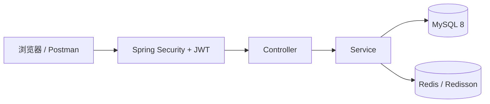

# 实验室设备预约系统

面向高校师生的实验室设备预约平台。把线下口头协调和 Excel 登记，变成线上可查、可约、可审批的流程，解决"设备谁在用、哪个时段空着、怎么避免抢重"的问题。

> 状态: 🚧 开发中（2026.11 起）

## 核心功能

- 用户注册 / 登录（JWT）
- 设备分类与设备的增删改查
- 按日期查询设备可用时段
- 创建预约（时间段冲突检测 + 并发抢约防护）
- 预约审批流（教师 / 管理员）
- 我的预约、取消预约
- 设备使用率与预约趋势统计（管理员）
- 水平越权（IDOR）防护

## 技术栈

| 层 | 选型 | 为什么 |
| --- | --- | --- |
| JDK | 17 (LTS) | Spring Boot 3 的最低要求，长期支持 |
| 框架 | Spring Boot 3.2 | 主流后端框架，生态完整 |
| 安全 | Spring Security 6 + JWT | 无状态认证，面试高频 |
| ORM | MyBatis-Plus 3.5 | 国内后端主流，减少样板代码 |
| 数据库 | MySQL 8.0 | 预约数据需要事务与强一致 |
| 缓存 / 锁 | Redis + Redisson | 分布式锁解决并发抢约 |
| 接口文档 | Knife4j | 自动生成，调试方便 |
| 部署 | Docker Compose | 一条命令起 MySQL + Redis |
| 构建 | Maven | — |

## 系统架构



## 核心设计

### 1. 时间段冲突检测

两个区间 `[a1, a2)` 与 `[b1, b2)` 重叠，当且仅当 `a1 < b2 AND a2 > b1`。因此一条 SQL 即可判断，不需要逐段比较:

```sql
SELECT COUNT(*) FROM reservation
WHERE device_id = #{deviceId}
  AND status IN ('PENDING', 'APPROVED')
  AND start_time < #{endTime}
  AND end_time   > #{startTime}
```

### 2. 并发抢约

两个请求同时通过检测，会双双落库。用 Redisson 分布式锁，锁粒度为 `lock:device:{deviceId}`，在锁内完成"检测 + 插入"；获取锁失败返回 409。

### 3. 水平越权防护

预约详情、取消等接口只能操作本人数据，管理员例外；越权访问返回 403。

## 本地运行

```bash
docker compose up -d
docker exec -it lab-mysql mysql -uroot -proot123 -e "show databases;"
```

MySQL 首次启动需要 20–40 秒。默认账号仅用于本地开发，不要用于生产环境。

## 里程碑

| 周 | 内容 | 状态 |
| --- | --- | --- |
| 第 1 周 | 环境 + 用户模块（注册 / 登录 / JWT） | 🚧 |
| 第 2 周 | 设备 + 分类 + 权限 | ⬜ |
| 第 3 周 | 预约 + 冲突检测 + 分布式锁 + 审批 | ⬜ |
| 第 4 周 | 统计 + 部署 + 压测 + 文档 | ⬜ |
